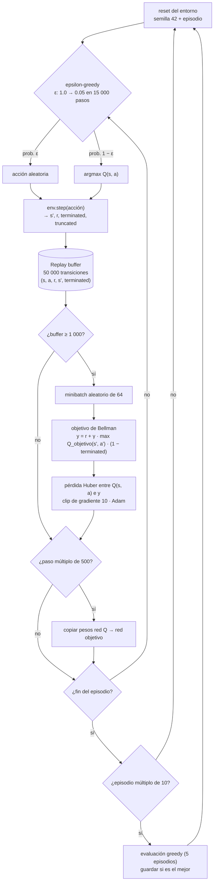
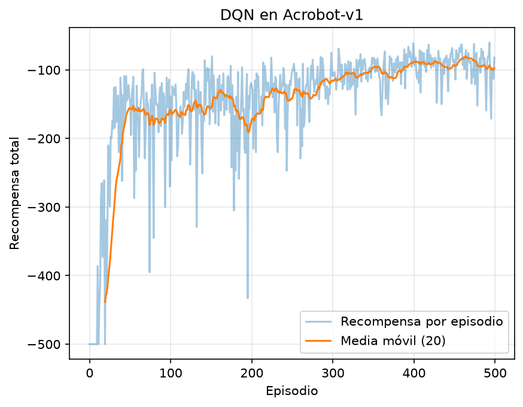

# Maestría en Inteligencia Articial.

# Simulación y Aprendizaje por Refuerzo.

# Grupo:
- valeriagume@unisabana.edu.co
- felipeba@unisabana.edu.co
- angieeshu@unisabana.edu.co
- luisgarccam@unisabana.edu.co
- andresmidi@unisabana.edu.co
- luis.uribe2@unisabana.edu.co
- juanmorme@unisabana.edu.co


# DQN en Acrobot-v1 (Gymnasium)

Agente DQN que resuelve el entorno **Acrobot-v1**.

Documentación: https://gymnasium.farama.org/environments/classic_control/acrobot/

## Entorno
Brazo de dos eslabones colgado de un punto fijo. 
En este problema solo se aplica torque en la articulación central. El objetivo es subir el extremo del segundo eslabón por encima de una línea de referencia.

| Elemento | Descripción |
|---|---|
| **Observaciones** | `Box(6)`: cos θ1, sin θ1, cos θ2, sin θ2, velocidad angular θ1, velocidad angular θ2 |
| **Recompensa** | -1 por cada paso hasta alcanzar la meta (por eso mejor = menos negativo; rango de -500 a ≈ -60) |
| **Terminación** | *terminated*: el extremo libre supera la altura objetivo. *truncated*: se llegan a 500 pasos |


### Acciones

`Discrete(3)`: en cada paso el agente elige un entero que define el torque aplicado en la articulación entre los dos eslabones.

| Acción | Torque | Efecto |
|---|---|---|
| 0 | -1 | Empuja el segundo eslabón en sentido negativo |
| 1 | 0 | No aplica fuerza. El brazo se mueve por inercia y gravedad |
| 2 | +1 | Empuja el segundo eslabón en sentido positivo |

Es importante añadir que solo la articulación central tiene actuador, por lo que el agente no puede levantar el brazo directamente, **debe aprender a balancearlo**, aplicando el torque en el momento justo para ganar energía en cada oscilación. La red tiene 3 salidas, una por acción, y el agente elige la de mayor valor Q.


### Observaciones

En cada paso el agente recibe un vector de 6 valores reales que describe el estado completo del brazo:

| Índice | Variable | Rango | Unidad |
|---|---|---|---|
| 0 | cos θ1 | [−1, 1] | — |
| 1 | sin θ1 | [−1, 1] | — |
| 2 | cos θ2 | [−1, 1] | — |
| 3 | sin θ2 | [−1, 1] | — |
| 4 | θ̇1 (velocidad angular del eslabón 1) | [−4π, 4π] ≈ [−12.57, 12.57] | rad/s |
| 5 | θ̇2 (velocidad angular del eslabón 2) | [−9π, 9π] ≈ [−28.27, 28.27] | rad/s |

- **Tipo:** `Box(low, high, shape=(6,), dtype=float32)`.
- **θ1** es el ángulo del primer eslabón respecto a la vertical, y **θ2** el del segundo eslabón respecto al primero. Con θ1 = θ2 = 0 el brazo cuelga hacia abajo.
- **Por qué seno y coseno en vez del ángulo:** el ángulo crudo salta de π a −π al dar la vuelta, aunque físicamente la posición sea casi la misma. Con (cos θ, sin θ) la representación es continua y la red no ve discontinuidades falsas.
- **Por qué no se apilan frames:** a diferencia de los ambientes con imágenes (como Atari), aquí la observación ya incluye las velocidades. Un solo vector describe el estado completo (es Markov), así que no hace falta historia.
- **Preprocesamiento:** ninguno. El vector entra a la red tal como lo entrega el entorno. Las escalas son distintas: los primeros cuatro valores están en [−1, 1], mientras que con el agente entrenado θ̇2 llega a ±12.3 rad/s, con una desviación estándar de 3.6 frente a ~0.7 de los senos y cosenos.
- **Estado inicial:** θ1, θ2, θ̇1 y θ̇2 se muestrean uniformes en [−0.1, 0.1]. El brazo empieza casi colgando y quieto.
- **Recompensa asociada:** −1 por cada paso mientras no se alcance la meta y 0 en el paso en que se alcanza. La meta es `−cos θ1 − cos(θ1 + θ2) > 1`, es decir, el extremo libre por encima de la línea de referencia.


## El agente
- Red: `6 → 128 → 128 → 3` (ReLU). 
    - Entrada = tamaño de la observación.
    - Salida = un valor Q por acción.

- Replay buffer (50 000), red objetivo (copia cada 500 pasos), epsilon-greedy lineal 1.0 -> 0.05 en 15 000 pasos.
- Cada 10 episodios se evalúa la política greedy (5 episodios) y se guarda el mejor checkpoint.
- Adam (lr 1e-3), γ = 0.99, batch 64, pérdida Huber, 500 episodios, semilla 42.
- Solo `terminated` corta el bootstrap. `truncated` no se trata como estado final.

## Flujo lógico del entrenamiento



1. **Interacción.** En cada paso se elige una acción con epsilon-greedy. ε baja linealmente de 1.0 a 0.05 durante los primeros 15 000 pasos y después se queda fijo en 0.05.
2. **Memoria.** Cada transición `(s, a, r, s', terminated)` se guarda en un replay buffer de 50 000 posiciones. Muestrear de él al azar rompe la correlación entre pasos consecutivos.
3. **Aprendizaje.** Cuando el buffer tiene al menos 1 000 transiciones, en **cada paso** del entorno se toma un minibatch de 64 y se hace una actualización: se compara Q(s, a) con el objetivo de Bellman `y = r + γ · max_a' Q_objetivo(s', a') · (1 − terminated)`, usando pérdida Huber, clip de gradiente a norma 10 y Adam.
4. **Red objetivo.** Cada 500 pasos se copian los pesos de la red Q a la red objetivo. Así el objetivo `y` se mantiene fijo por un tiempo y el aprendizaje no persigue un blanco que se mueve en cada actualización.
5. **Evaluación y checkpoint.** Cada 10 episodios se juegan 5 episodios sin exploración (semillas 10 000 a 10 004) y se guarda el modelo solo si supera al mejor anterior.

### Particularidades del ambiente

- **La recompensa casi no da señal.** Como vale −1 en cada paso, todos los episodios fallidos suman exactamente −500 y no informan si el agente estuvo cerca de la meta. Medimos esto con 20 episodios (semillas 500 a 519):

  | Política | Recompensa media | Llega a la meta |
  |---|---|---|
  | Aleatoria | −500 ± 0 | 0 / 20 |
  | Sin torque (siempre acción 1) | −500 ± 0 | 0 / 20 |

  Por eso la exploración es crítica: la primera señal útil llega con el primer éxito. En `rewards.csv` eso ocurre en el **episodio 11**, después de unos 5 000 pasos, cuando ε todavía estaba cerca de 0.68.
- **Sistema subactuado.** Solo la articulación central tiene motor, y el torque (±1) no alcanza para levantar el brazo directamente. El agente tiene que balancearlo y sumar energía en cada oscilación, lo que exige planificar decenas de pasos hacia adelante. Por eso se usa γ = 0.99: el horizonte efectivo es de ~1/(1−γ) = 100 pasos, del mismo orden que la duración de un episodio exitoso.
- **`terminated` frente a `truncated`.** El episodio termina (`terminated`) cuando el extremo cruza la línea, y se corta (`truncated`) a los 500 pasos. Solo `terminated` es un estado final real. En el código, solo `terminated` anula el término `γ · max Q_objetivo(s')`; en un corte por tiempo se sigue estimando el valor futuro, porque el brazo no llegó a un estado terminal.
- **Escala de los valores Q.** Como todas las recompensas son −1 o 0, los valores Q son negativos y están acotados en −1/(1−γ) = −100. La red entrenada estima Q ≈ −67 en el estado inicial. Esto justifica la pérdida Huber, que evita gradientes muy grandes cuando los errores iniciales son altos.
- **Dinámica determinista.** El entorno no agrega ruido al torque (`torque_noise_max = 0`). La única aleatoriedad está en el estado inicial, y el paso de integración es dt = 0.2 s.

## Explicación de la red neuronal

Se usa un **perceptrón multicapa (MLP)** que recibe la observación y devuelve un valor Q por acción:

| Capa | Entrada → Salida | Activación | Parámetros |
|---|---|---|---|
| Lineal 1 | 6 → 128 | ReLU | 6·128 + 128 = 896 |
| Lineal 2 | 128 → 128 | ReLU | 128·128 + 128 = 16 512 |
| Salida | 128 → 3 | ninguna (lineal) | 128·3 + 3 = 387 |
| **Total** | | | **17 795** |

La red objetivo tiene exactamente la misma arquitectura: es una copia de la red Q que se actualiza cada 500 pasos.

**Justificación del diseño**
- **MLP y no CNN.** La entrada es un vector de 6 números, no una imagen, así que no hay estructura espacial que aprovechar. No hay kernels ni strides.
- **Dos capas ocultas de 128.** La dinámica del doble péndulo no es lineal, pero el estado es de baja dimensión. Dos capas de 128 bastan para representar la relación entre estado y valor, sin tantos parámetros que el aprendizaje se vuelva lento o inestable.
- **ReLU** en las capas ocultas, porque es estándar, barata y no satura en los valores positivos.
- **Salida lineal con 3 neuronas.** Los valores Q son negativos (entre 0 y −100), así que la salida no puede tener una activación acotada. Con una neurona por acción, una sola pasada da los tres Q(s, a), y la acción greedy es su `argmax`.

**Hiperparámetros** (tomados de `train.py`):

| Hiperparámetro | Valor | Razón |
|---|---|---|
| Episodios | 500 | Suficientes para pasar del primer éxito a una política estable |
| γ | 0.99 | La meta exige planificar ~100 pasos (ver particularidades) |
| Tasa de aprendizaje (Adam) | 5e-4 | Paso moderado: más alto desestabiliza los objetivos de Bellman, más bajo hace lento el aprendizaje |
| Tamaño de minibatch | 64 | Equilibrio entre el ruido del gradiente y el costo por actualización |
| Replay buffer | 50 000 | Guarda muchos episodios distintos, de modo que las muestras no se parezcan entre sí |
| Inicio del aprendizaje | 1 000 pasos | Evita entrenar con un buffer casi vacío y muy correlacionado |
| Actualización de la red objetivo | cada 500 pasos | Mantiene el objetivo fijo el tiempo suficiente para estabilizar |
| ε inicial → final | 1.0 → 0.05 en 15 000 pasos | Mucha exploración al principio, necesaria por la recompensa escasa, y un 5 % residual después |
| Pérdida | Huber (`smooth_l1`) | Es robusta a errores grandes cuando los Q todavía están mal estimados |
| Clip de gradiente | norma 10 | Evita actualizaciones explosivas |
| Semilla | 42 | Reproducibilidad |

## Uso
```bash
python -m venv venv
source venv/bin/activate        # Windows: venv\Scripts\activate
pip install -r requirements.txt
python train.py                 # entrena y guarda modelo, rewards.csv y training_curve.png
python evaluate.py              # evalúa 20 episodios sin exploración
python evaluate.py --render     # ver al agente en ventana
```

## Resultados


Evaluación con `evaluate.py` (20 episodios, política greedy, semillas distintas a las usadas para elegir el modelo):

| Métrica | Valor |
|---|---|
| Recompensa media | -82 ± 10.3 |
| Mín / Máx | -107 / -68 |

**Nota:** Vemos que DQN es inestable en Acrobot. Durante el entrenamiento la política greedy oscila entre buenos resultados y -500 entre un checkpoint y otro. Por eso `train.py` evalúa cada 10 episodios y **guarda el mejor modelo**, no el último.

## Archivos
- `train.py`: red, entrenamiento y gráfica.
- `evaluate.py`: evaluación del modelo guardado.
- `sabana_dqn_rl.pth`: pesos entrenados.
- `rewards.csv`: recompensa por episodio.
